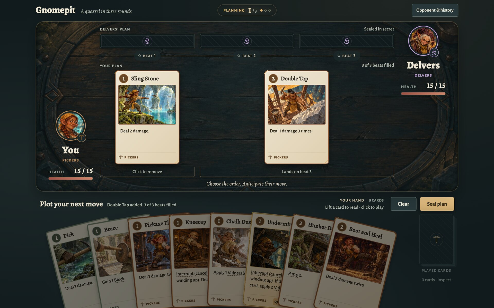

# Gnomepit

Gnomepit is a two-player card duel between gnome clans beneath a mountain. Both players plan their moves in secret, then both plans resolve at once, so a match is won on reading your opponent and timing your cards.

Play it at <https://gfanton.github.io/gnomepit/>.

## Ways to play

The page offers four ways to play. The first three need no account and no wallet.

- **Guided match**: a first match that teaches the rules as you play. Start it from **How to play**.
- **Against the bot**: a full match against a computer opponent.
- **Two players**: two people sharing one device, passing it between plans.
- **Online**: a match against another player on the [Gno](https://gno.land) onyx testnet, with a ranking for players and for clans. It needs the [Adena](https://adena.app) wallet and onyx GNOT. The realm `r/arena` holds each match and checks every move with the same rules engine the page runs.

## How a match works

Each player chooses a clan, Pickers, Ironhide or Delvers, then builds a deck of eight special cards from that clan's pool of ten, including its one Rare. Two basic cards are always available as well: Pick, which hits for 1, and Brace, which blocks 1.

Both gnomes start at 15 HP. A match lasts at most three rounds, and each round has three beats:

1. Both players plan the round in secret, filling its three beats with cards. A card costs 1 to 3 beats, and the costs must add up to 3.
2. Both plans are sealed, then revealed together.
3. The beats resolve one by one, both gnomes acting on the same beat.

Basics can be played every round. Each special card can be played once per match. A gnome that reaches 0 HP loses at once, and if both do on the same beat the match is a draw. After the third round, the gnome with more HP wins, and equal HP is a draw.

Cards carry keywords that decide how they interact on a beat. An Interrupt cancels an opponent's card that is still winding up, a Parry cancels attacks that land while it is active, Block absorbs damage, Counter sends it back, Vulnerable doubles the next hits a gnome takes, and Strength adds 1 to each hit a gnome deals. The page explains each keyword when you hover or focus it on a card.

## Contribute and get help

[`CONTRIBUTING.md`](CONTRIBUTING.md) covers running the game locally, playing online against a local chain, the tests, and how the repository is laid out. [`client/ONLINE.md`](client/ONLINE.md) covers online play in depth: the wallet and session keys, the arena API, storage and gas costs, and the onyx deploy.

Report a bug or suggest a card in [the issues](https://github.com/gfanton/gnomepit/issues). Report a vulnerability privately, as [`SECURITY.md`](SECURITY.md) describes.

## License

[Apache-2.0](LICENSE), covering the code, the docs and the art.
